<div align="center">

# ◆ KYBER OS

**An Imperial-console desktop for KDE Plasma 6 and Cinnamon**

Cold steel, chamfered panels, kyber-crystal light and hyperspace.<br>
The screens on Star Wars ships and bases, recreated as a desktop you can actually use.


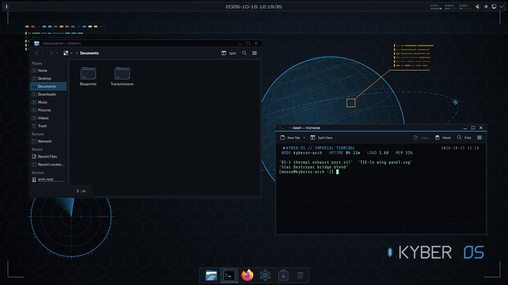

</div>

## Contents

- [Every monitor gets its own station](#every-monitor-gets-its-own-station)
- [What's in it](#whats-in-it)
- [Gallery](#gallery)
- [Kyber crystals](#kyber-crystals)
- [Cinnamon](#cinnamon)
- [Install](#install)
- [Removing it](#removing-it)
- [Supported systems](#supported-systems)
- [Under the hood](#under-the-hood)
- [Credits and licence](#credits-and-licence)

## Every monitor gets its own station

The wallpaper is drawn live, not a picture, so it stays sharp at any resolution and any
shape of screen. Each monitor picks a scene from its orientation and position:

- landscape screens get **Tactical**;
- a portrait screen left of centre gets **Targeting**;
- a portrait screen right of centre gets **Comms**;
- you can pin any monitor to any scene, **Schematic** included.

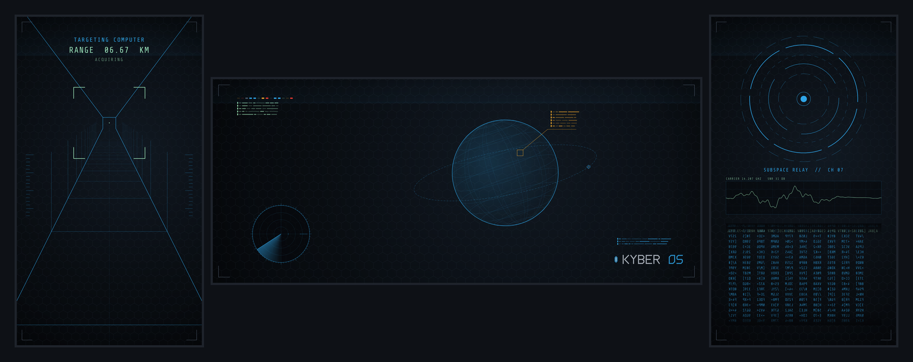

| Tactical | Schematic |
|:---:|:---:|
| 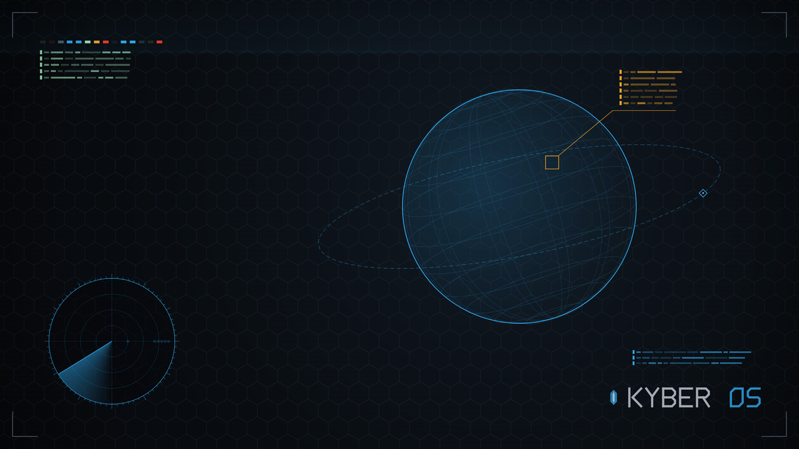 | 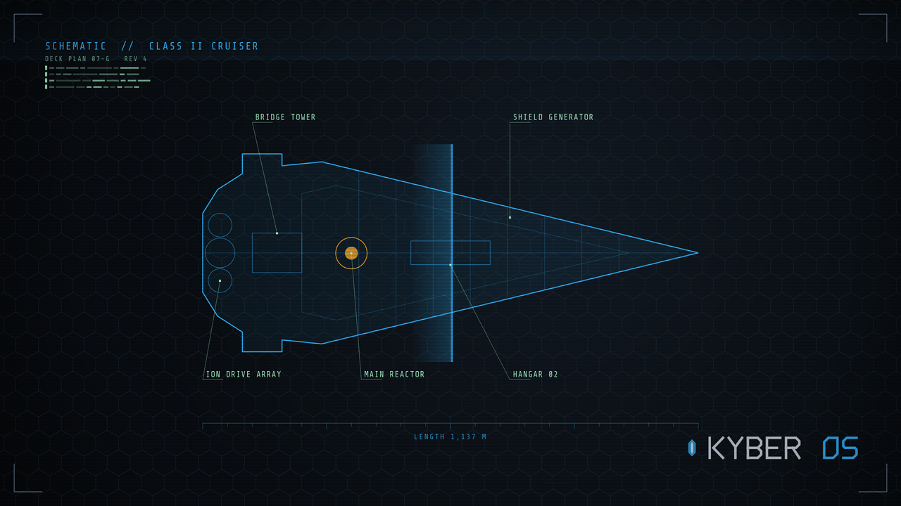 |
| A rotating wireframe planet, a tracked contact on orbit, a target lock and a radar sweep with blips. | A capital-ship blueprint with labelled systems, a dimension ruler, a pulsing reactor and a scanning beam. |

| Targeting | Comms |
|:---:|:---:|
| 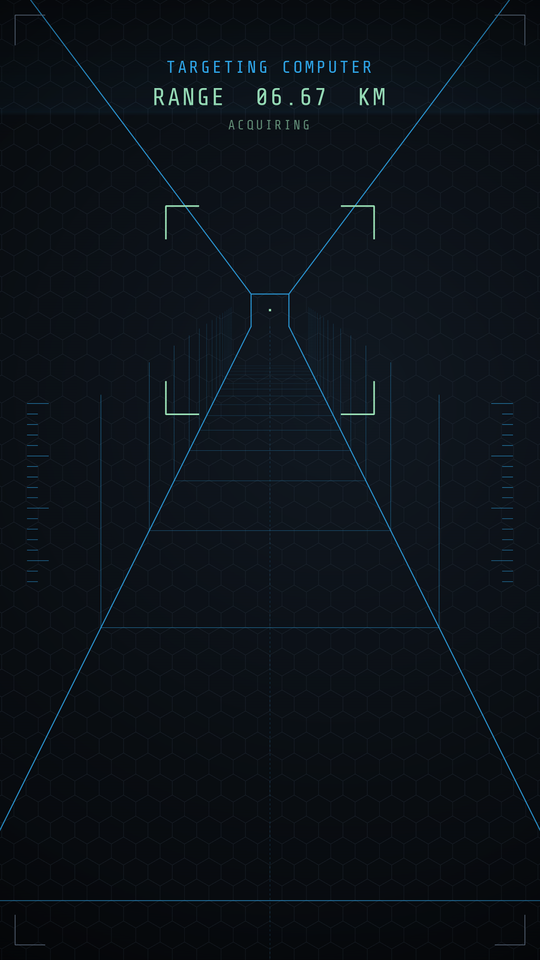 | 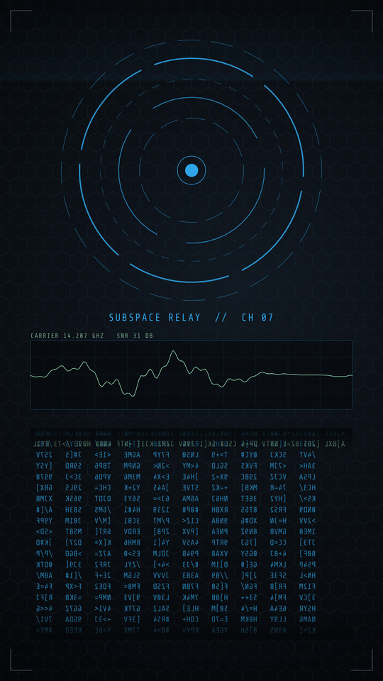 |
| A trench run rushing toward you. The reticle closes in as the range counts down to TARGET LOCKED. | A spinning relay array, a live waveform and scrolling glyph data columns. |

A small background service (`kyberos-screens`) gives newly connected monitors the animated
wallpaper too, since Plasma hands every new screen its stock image.

## What's in it

**Desktop**
- **Top command strip:** clock, pager, tray, and a live **CPU / RAM / DISK** diagnostics
  widget. Its popup adds CPU temperature, per-core load, GPU (when present), network and disk I/O.
- **Floating dock** that grows as you pin apps. `--layout` carries your existing pinned
  apps over.
- **Plasma style:** chamfered steel panels, glass popups with soft shadows, lightsaber
  progress bars, diamond radio buttons and a reticle busy indicator.
- **Icons, cursors and window decorations** to match, plus a colour scheme in each crystal.

**Motion**
- **Holoprojector windows:** apps are projected out of their dock icon as a flickering
  hologram that settles into the real window. Dialogs and notifications shimmer in place.
- **Power-down close:** every closing window collapses like an old CRT, first to a line,
  then to a point.
- **Star Wars wipe** when you switch virtual desktops.
- **Alt+Tab "SELECT TARGET"** console, with amber lock brackets on the selected window.

**Login and boot**
- **Hyperspace boot splash** (Plymouth) with a lightsaber progress bar.
- **Login screen:** the same animated display with an *IMPERIAL NETWORK // IDENTIFY* panel.
  It's an SDDM theme or a Plasma Login Manager setup, whichever your distro uses. A wrong
  code shakes the panel with *ACCESS DENIED*.
- **Lock screen:** the tactical display with an *AUTHORIZATION REQUIRED* banner.
- **POWER SYSTEMS** logout screen with a targeting ring around your avatar.

**Apps and extras**
- **Kvantum app style:** Qt apps such as Dolphin and System Settings get steel buttons,
  chamfered fields and tabs, diamond radios and saber progress bars.
- **Terminal:** a Konsole colour scheme and a status greeting with node, uptime, load and
  memory.
- **Sound theme:** original synthesized console sounds.
- Every piece of artwork, sound and code is original. There are no film assets, logos or
  audio.

## Gallery

| Login (SDDM) | Lock screen |
|:---:|:---:|
| 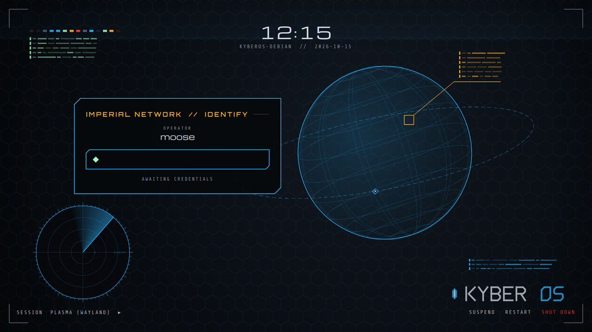 | 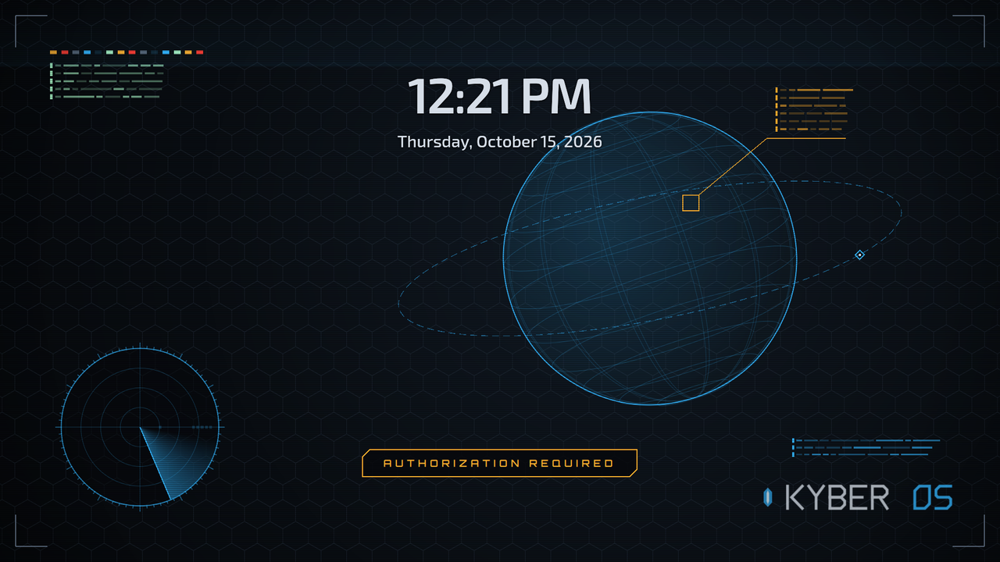 |

| Boot splash | Logout |
|:---:|:---:|
| 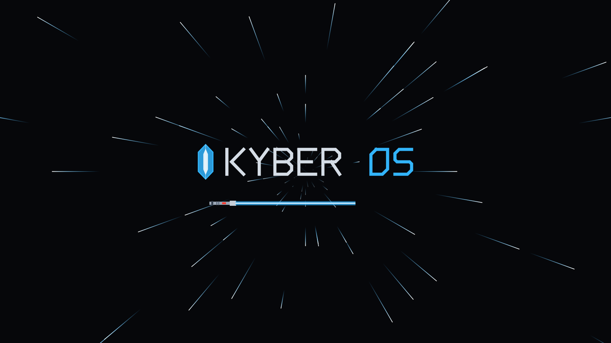 | 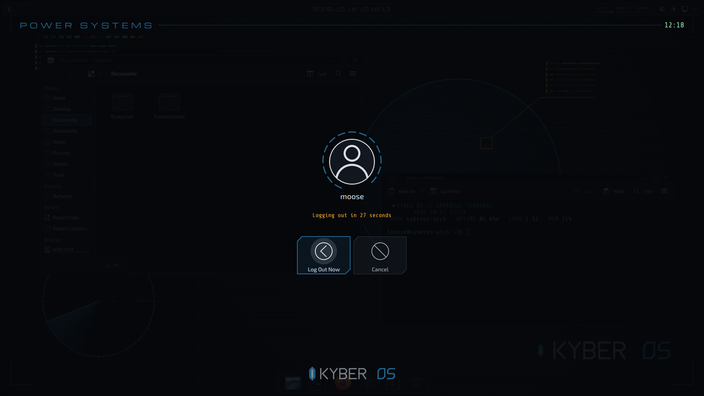 |

| Alt+Tab | App style (Kvantum) |
|:---:|:---:|
| 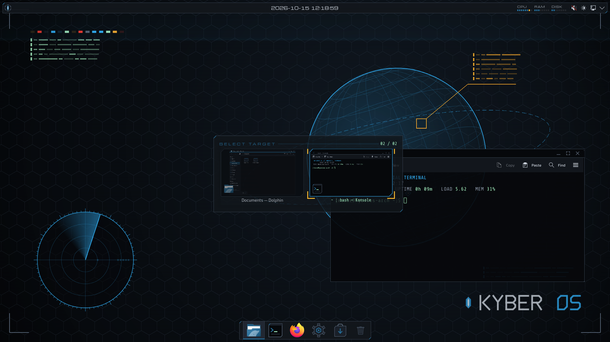 | 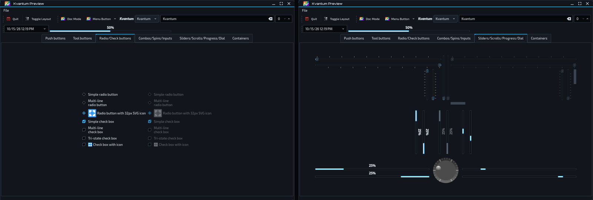 |

## Kyber crystals

Six crystals: **blue**, **green**, **red**, **purple**, **yellow** and **white**. Switching
re-tunes everything at once: colours, cursor, window borders, effects, app style,
terminal, wallpaper and lock screen.

```bash
kyberos-crystal red
```

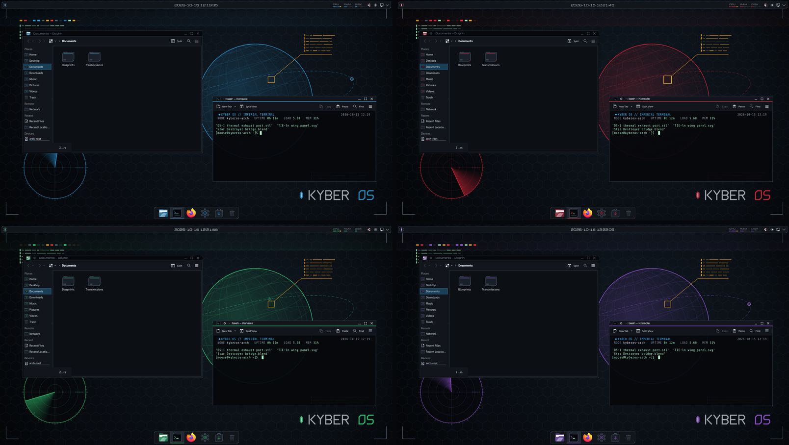

## Cinnamon

KyberOS also runs on **Cinnamon**: Linux Mint and the Fedora and Arch Cinnamon spins.
`install.sh` detects which desktop you're on.

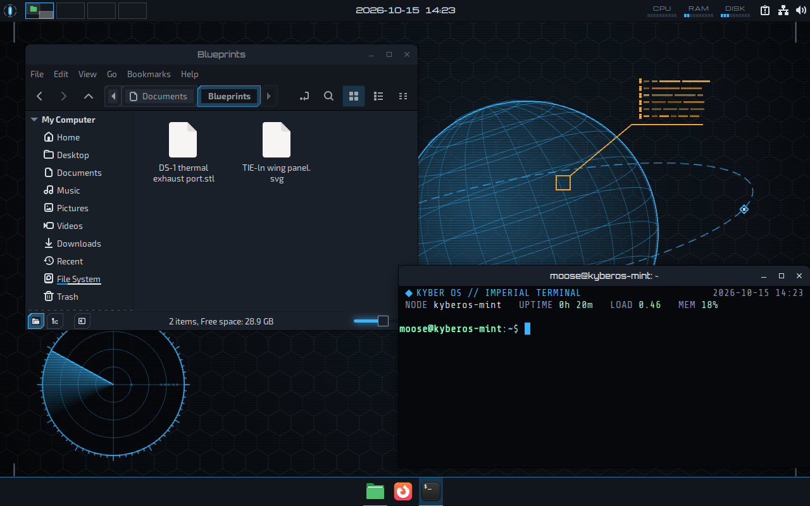

**What's the same:**
- the four scenes, one per monitor;
- the window animations: the holoprojector open and the power-down close;
- icons, cursors, sounds, the boot splash and the terminal greeting;
- all six crystals.

**What's built for Cinnamon:**
- **App theme:** a GTK 3/4 theme (based on Mint-Y, re-cut in KyberOS steel), which also
  draws the window borders.
- **Shell theme:** the panel, menu, calendar, notifications, OSD, Alt+Tab and the
  logout/shutdown dialog.
- **Diagnostics applet:** a *Ship Diagnostics* applet for the panel.
- **Window animations:** a Cinnamon extension (*KyberOS Holoprojector*). It uses the same
  shaders as the Plasma effect.
- **Login screen:** for slick-greeter or lightdm-gtk-greeter, with a tactical background
  rendered for it.
- **Lock screen:** cinnamon-screensaver with a Michroma clock and an *AUTHORIZATION
  REQUIRED* message.

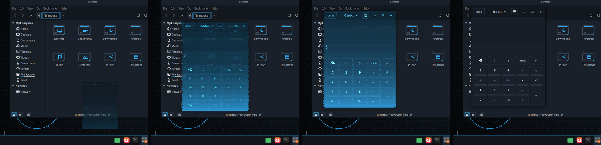

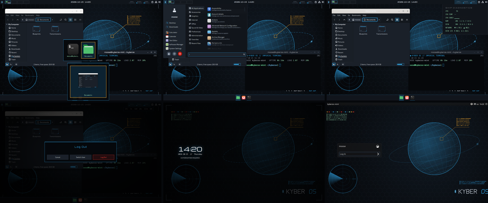

**Wallpaper:** Cinnamon can't run live wallpapers, so `kyberos-wallpaper` renders each
monitor's scene at its exact size into one image laid out like your desktop. It renders
again whenever you plug in, unplug or rotate a monitor.
- **Pin a scene:** add a line such as `DP-2=schematic` to `~/.config/kyberos/scenes.conf`.
- **Live backdrop (experimental):** `kyberos-live on` runs the animated scenes behind your
  windows. Desktop icons may be hidden while it runs. `kyberos-live off` turns it off.

## Install

You need **KDE Plasma 6.3+** or **Cinnamon 6+**, on Fedora, Debian/Ubuntu or Arch, or a
derivative such as Linux Mint, Kubuntu, KDE neon, EndeavourOS or CachyOS.

```bash
git clone https://github.com/TheMooseSaysMoo/kyberos.git
cd kyberos
./install.sh --layout --system
```

You can also download a release from the
[Releases page](https://github.com/TheMooseSaysMoo/kyberos/releases), unpack it and run
`./install.sh` the same way. The installer:
- pulls in its few dependencies with your package manager (asking for sudo);
- fetches the fonts (Orbitron, Michroma, Share Tech Mono, Exo 2, all SIL OFL) from Google
  Fonts;
- builds every asset locally and applies the theme.

| Option | What it does |
|---|---|
| *(none)* | Install and apply the theme for your user. Your panels stay as they are, restyled. |
| `--layout` | Replace your panels with the KyberOS top strip and dock (Cinnamon: top strip + centred task bar). Your pinned apps carry over. |
| `--system` | Also install the boot splash and login screen. Needs sudo, and rebuilds the initramfs. |
| `--crystal <name>` | Start with another crystal (default: blue). |
| `--live` | Cinnamon: also run the animated live backdrop (experimental). |
| `--desktop plasma\|cinnamon` | Skip desktop detection. |
| `--no-apply` | Install the files without switching to them. |

**Choosing scenes:**
- **Plasma:** right-click the desktop → *Configure Desktop and Wallpaper* → *Scene*.
- **Cinnamon:** add a line to `~/.config/kyberos/scenes.conf`.

**Want a safety net first?** Take a full snapshot of your current desktop before
installing. It records your panels, theme, configs and boot and login setup. If the system
uses btrfs with snapper, it also takes OS and `/home` snapshots.

```bash
tools/rollback/snapshot.sh          # your desktop, no sudo
sudo system/rollout.sh              # system snapshot + packages + boot splash + login screen
./install.sh --layout               # then the desktop
```

> [!NOTE]
> The window animations need GPU acceleration. On software rendering (some VMs), KWin
> turns all animations off unless you set `KWIN_EFFECTS_FORCE_ANIMATIONS=1`.

## Removing it

```bash
./uninstall.sh --system                      # remove KyberOS and restore the settings it changed
tools/rollback/restore.sh --system           # or: put back the exact snapshot taken before
```

`restore.sh` moves whatever it replaces aside first, so a restore can be undone too. Every
option, including btrfs and snapper rollback, is in [docs/ROLLBACK.md](docs/ROLLBACK.md).

## Supported systems

| Distro | Tested on | Login screen | Initramfs |
|---|---|---|---|
| Fedora | Fedora 44 · Plasma 6.7.5 | Plasma Login Manager (or SDDM) | dracut |
| Arch and derivatives | Arch 2026.10 · Plasma 6.7.5 · Qt 6.12 | SDDM (Qt 6 greeter) | mkinitcpio (or dracut) |
| Debian, Ubuntu and derivatives | Debian 13 · Plasma 6.3.6 · Qt 6.8 | SDDM (Qt 6 greeter) | initramfs-tools |
| Linux Mint (Cinnamon) | Mint 22.3 · Cinnamon 6.6 · Qt 6.4 | LightDM slick-greeter | initramfs-tools |

- **Boot splash:** the boot animation needs `splash` on the kernel command line, and on
  Arch the `plymouth` mkinitcpio hook. The installer tells you if either is missing; it
  never edits your bootloader.
- **On-screen keyboard:** the SDDM theme turns off SDDM's on-screen keyboard. Touchscreen
  users can turn it back on by setting `InputMethod=qtvirtualkeyboard` in
  `/etc/sddm.conf.d/`.
- **Lock screen:** its layout belongs to Plasma itself, so only its background and banner
  are themed.
- **Cinnamon updates:** Muffin keeps a session's window-border style cached. After
  updating over an existing install, restart Cinnamon (Ctrl+Alt+Esc). The installer
  reminds you.
- **Cinnamon on Qt apps:** Qt 6 Kvantum isn't packaged for Mint 22, so on Cinnamon only
  GTK apps get the KyberOS app style.

## Under the hood

Every asset is generated from one palette ([`build/palette.py`](build/palette.py)) by
[`build/build.py`](build/build.py). That covers SVG Plasma frames, Kvantum, window borders,
icons, cursors, sounds, the Plymouth theme and wallpapers. No generated assets are checked in;
the only images in the repo are these README previews.
[`lib/distro.sh`](lib/distro.sh) holds everything that differs between distros.
[docs/COMPONENTS.md](docs/COMPONENTS.md) maps every component to its source, and lists the
Plasma quirks found along the way.

```
build/       generators (Python) + palette
src/         hand-written QML: wallpaper scenes, widgets, KWin effects, Alt+Tab, SDDM theme;
             src/cinnamon: applet, effects extension, backdrop runners, vendored Mint-Y base
lib/         distro + desktop detection, package names, initramfs/plymouth/display managers;
             install-cinnamon.sh (the Cinnamon half of install.sh)
system/      boot splash + login screen install, snapshots, restore (root)
tools/       rollback scripts, screenshot helpers
```

## Credits and licence

- **Licence:** KyberOS is free software under the [GNU GPL v3 or later](LICENSE).
- **KDE-derived parts:** the logout screen is adapted from KDE's Breeze (GPL-2.0-or-later,
  © Marco Martin and KDE contributors).
- **Mint-derived parts:** the Cinnamon GTK and shell themes start from Linux Mint's Mint-Y
  ([mint-themes](https://github.com/linuxmint/mint-themes), GPL-3.0-or-later, © Clement
  Lefebvre and the Linux Mint team). KyberOS recolors and restyles it at build time.
- **Fonts** ([SIL Open Font License](https://openfontlicense.org)) are downloaded from
  [Google Fonts](https://github.com/google/fonts) at install time and aren't redistributed
  here.

KyberOS is an unofficial fan project. It isn't affiliated with, endorsed by or sponsored by
Lucasfilm Ltd. or The Walt Disney Company. *Star Wars* is a trademark of Lucasfilm Ltd.
